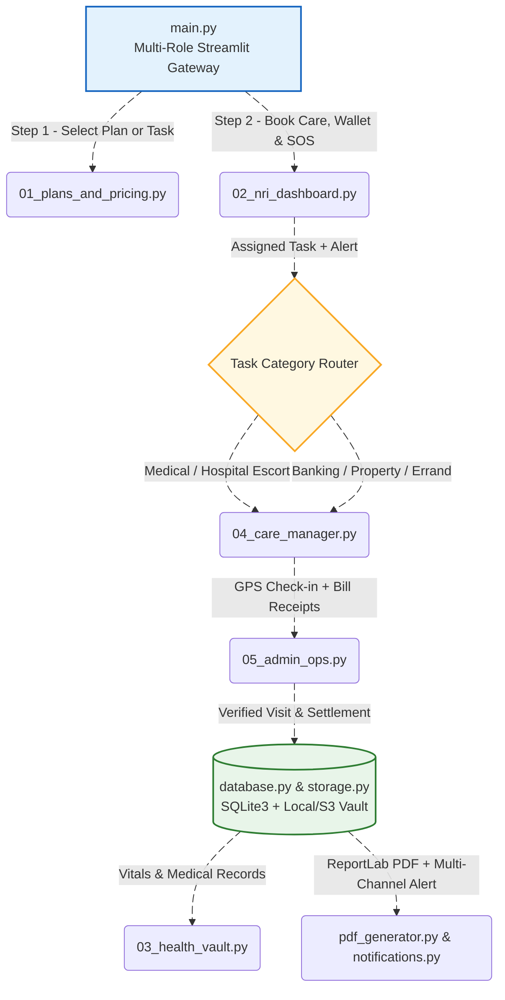
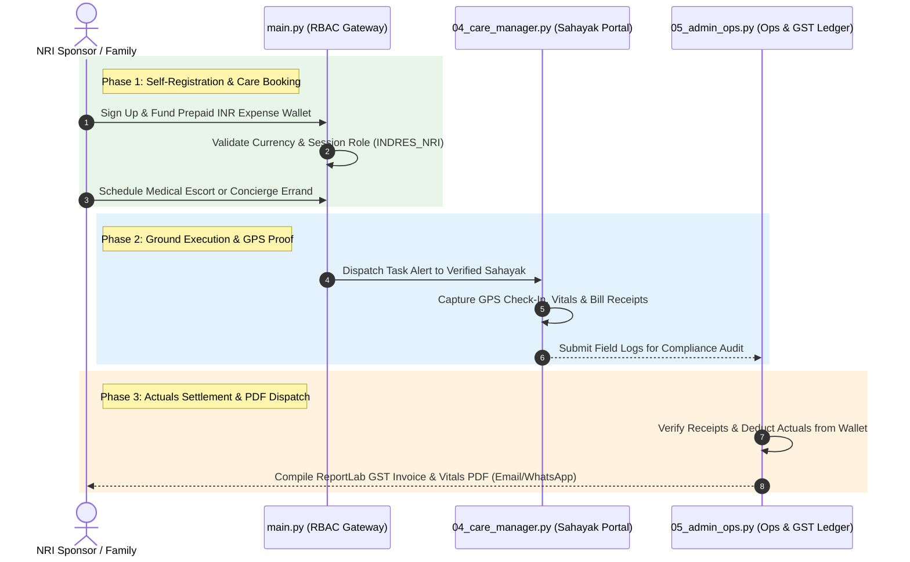

# 🏥 CareBridge India — NRI Parent Care & Concierge Platform

A cloud-ready financial and healthcare operations workstation built with Streamlit for Non-Resident Indians (NRIs) to manage geriatric medical monitoring, daily errands, 24/7 emergency support, itemized GST PDF invoicing, and property concierge services for aging parents in India.


## 🏛️ System Architecture

The platform decouples core persistence, multi-currency GST computation, and ReportLab document compilation from the multi-role Streamlit presentation layer to maintain a transparent, real-time operational workflow.



### Onboarding, RBAC & Service Fulfillment Pipeline



---

## 📁 Repository Directory Tree

```text
📁 carebridge-nri-platform/
├── 📁 .github/
│   └── 📁 workflows/
│       └── ci-cd.yml                 # Automated linting, unit tests, and security checks on push
├── 📁 .streamlit/
│   ├── config.toml                   # Custom medical-teal theme, fonts, and 25 MB upload limit
│   └── secrets.toml.example          # Template for Stripe, Razorpay, Twilio, SMTP, and S3 keys
├── 📁 app/
│   ├── main.py                       # Main entry point, session initialization, and role-based router
│   ├── 📁 assets/
│   │   ├── logo.png                  # Brand logo and favicons
│   │   └── styles.css                # Custom CSS overrides for cards, badges, and responsive UI
│   ├── 📁 auth/
│   │   ├── session_manager.py        # Role-based access control (NRI, Care Manager, Admin)
│   │   └── login_ui.py               # Role demo access and communication channel preferences
│   ├── 📁 pages/
│   │   ├── 01_plans_and_pricing.py   # Public USD/INR subscription plans and on-demand rate cards
│   │   ├── 02_nri_dashboard.py       # Service booking, prepaid wallet, SOS trigger, & PDF invoices
│   │   ├── 03_health_vault.py        # Medical reports, vitals trends, & PDF health report export
│   │   ├── 04_care_manager.py        # Ground staff GPS check-in, receipt upload, & auto-dispatch PDFs
│   │   └── 05_admin_ops.py           # Staff verification (KYC/Police ID), audit, & invoice ledger
│   ├── 📁 services/
│   │   ├── database.py               # Zero-setup SQLite3 CRUD operations for parents, tasks, & invoices
│   │   ├── storage.py                # Local Vault / AWS S3 handling for receipts, lab PDFs, & invoices
│   │   ├── payments.py               # Stripe (International USD/GBP/EUR) and Razorpay (INR) integration
│   │   ├── pdf_generator.py          # ReportLab engine for itemized PDF invoices & visit/vitals reports
│   │   └── notifications.py          # Email (PDF attachment), WhatsApp, and SMS multi-channel dispatch
│   ├── 📁 models/
│   │   └── schemas.py                # Pydantic data validation models for requests, vitals, & invoices
│   └── 📁 utils/
│       ├── currency.py               # Multi-currency conversion and 18% service-only GST math
│       └── validators.py             # Indian/international phone, Aadhaar mask, & file type checks
├── 📁 tests/
│   ├── test_billing.py               # Unit tests for currency math, GST invoices, & PDF generation
│   └── test_permissions.py           # Validation tests for phone numbers, Aadhaar masking, & uploads
├── .gitignore                        # Excludes *.db, local_vault/, secrets.toml, and __pycache__
├── Dockerfile                        # Container setup for scalable deployment (AWS ECS / GCP Cloud Run)
├── pyproject.toml                    # Code formatting (Ruff) and Pytest configuration
├── requirements.txt                  # Pinned production Python dependencies
└── README.md                         # Setup guide, pricing reference, and architecture diagram
```
---

## 📊 Monthly Care Subscription Tiers (`01_plans_and_pricing.py`)

The billing engine (`app/utils/currency.py`) dynamically converts subscription charges across **USD / INR / GBP / EUR** and applies **18% service-only GST** while keeping out-of-pocket medical and errand actuals strictly pass-through:

| Plan Tier | Monthly Charge (INR) | Monthly Charge (USD) | Included Coverage & Operational Invariants |
| :--- | :---: | :---: | :--- |
| **`ESSENTIAL_CARE`** *(Essential Errands & Check-Ins)* | **₹3,500 – ₹6,000** | **\$45 – \$75** | 2 planned home visits/month, utility bill payments, banking help, grocery coordination, and photo updates. |
| **`COMPLETE_MEDICAL`** *(Complete Medical + Errands)* | **₹7,500 – ₹12,500** | **\$90 – \$150** | 4 weekly visits, BP/blood sugar checks, doctor appointment escorting, medicine refills, and 24/7 SOS priority. |
| **`COUPLE_CARE`** *(Comprehensive / Couple Care)* | **₹14,000 – ₹22,000** | **\$170 – \$265** | Weekly visits covering **both parents**, hospital admission escorting, lab coordination, and locked property checks. |

---

## 💸 Pay-As-You-Go On-Demand Rate Card (`ON_DEMAND_SERVICES`)

Ad-hoc concierge and medical escort tasks are billed per completed visit with mandatory GPS check-in verification and digital receipt proofs prior to wallet deduction:

```text
┌───────────────────────────────────────────────┬─────────────────────┬─────────────────┐
│ On-Demand Service Category                    │ INR Rate Tranche    │ USD Equivalent  │
├───────────────────────────────────────────────┼─────────────────────┼─────────────────┤
│ Routine Home Wellbeing & Vitals Check         │ ₹600 – ₹1,200       │ \$8 – \$15      │
│ Bank, Government, or Pension Life Certificate │ ₹1,000 – ₹2,000     │ \$12 – \$25     │
│ Doctor / Hospital Visit Escort (up to 4 hrs)  │ ₹1,000 – ₹2,500     │ \$12 – \$30     │
│ Property / Locked Flat Inspection             │ ₹1,500 – ₹3,000     │ \$18 – \$36     │
│ Airport Pickup / Drop Assistance (+ actuals)  │ ₹1,500 – ₹3,500     │ \$18 – \$42     │
└───────────────────────────────────────────────┴─────────────────────┴─────────────────┘
```

---

## 🔐 Role-Based Access Control & Demo Credentials (`app/auth/session_manager.py`)

The gateway enforces a four-tier **RBAC** matrix across system administrators, verified ground staff (*Sahayaks*), and global NRI/resident family sponsors:

| System Role | Account Type | User Name | Login Email ID | Phone / WhatsApp | Password | Provisioning Workflow |
| :--- | :--- | :--- | :--- | :--- | :--- | :--- |
| **`SYSTEM_ADMIN`** | `SYSTEM` | Master System Admin | `sysadmin@carebridge.in` | `+919848000001` | `SysAdmin@123` | Pre-seeded automatically on startup |
| **`ADMIN`** | `STAFF` | Priya Nair | `priya.admin@carebridge.in` | `+919849054321` | `AdminOps@123` | Created by System Admin in Ops Console |
| **`CARE_MANAGER`** | `STAFF` | Suresh Naidu | `suresh.naidu@carebridge.in` | `+919848012345` | `Sahayak@123` | Created by System Admin in Ops Console |
| **`INDRES_NRI`** | `NRI_SPONSOR` | Karthik Reddy | `karthik.reddy@example.com` | `+14155550199` | `Client@123` | Self-registered via Public Sign-Up Tab |
| **`INDRES_NRI`** | `INDIAN_RESIDENT` | Smt. Lakshmi Narayana Rao | `lakshmi.rao@example.com` | `+919848022334` | `Resident@123` | Self-registered via Public Sign-Up Tab |

> **Cloud Persistence Note:** On Streamlit Community Cloud, container restarts reset ephemeral SQLite storage (`carebridge.db`) back to the default `SYSTEM_ADMIN` seed account.

---

## 🚀 Local Host Installation & Boot Instructions

To run the workstation engine locally on your authorized machine, follow these steps:

### 1. Configure the Local Environment & Install Dependencies
```bash
# 1. Access project workspace path
cd carebridge-nri-platform

# 2. Spawn targeted Python virtual node
python3 -m venv venv

# 3. Initialize terminal activation link context
# On macOS/Linux:
source venv/bin/activate
# On Windows PowerShell:
.\venv\Scripts\Activate.ps1

# 4. Ingest and compile required packages
pip install -r requirements.txt
```

### 2. Configure Optional API Secrets (Zero-Setup SQLite3 Works Out-of-the-Box)
Copy the secrets template if you wish to connect live Stripe, Razorpay, Twilio, SMTP, or AWS S3 credentials:
```bash
cp .streamlit/secrets.toml.example .streamlit/secrets.toml
```

### 3. Launch the Workstation Server on LocalHost
Boot the UI layer using Streamlit on `port 8501`:
```bash
streamlit run app/main.py
```
Access the application directly in your browser at:
👉 **`http://localhost:8501`**

### 4. Run Automated Billing & RBAC Diagnostic Suites
Verify multi-currency GST math, ReportLab PDF generation, and permission validators via PyTest:
```bash
pytest -v tests/
```

---

## ⚠️ Clinical & Operational Disclaimer

> **Important Notice:** This platform facilitates non-clinical care coordination, errand management, and home health monitoring. In the event of a critical medical emergency, local Care Managers coordinate immediate transport to the family's designated hospital, while all clinical diagnoses and treatments remain solely under the supervision of licensed medical practitioners.

---
## 🛡️ License, Copyright & Compliance Notices

**All Rights Reserved © 2026 T A Srinivas.**

> **Strict Intellectual Property Notice:** This repository is strictly for portfolio viewing and technical evaluation purposes. **DO NOT COPY, CLONE, FORK, OR REDISTRIBUTE** this source code, architecture, or documentation. Stolen copies or unauthorized forks will be reported immediately for a **GitHub DMCA copyright takedown**.

For corporate licensing, enterprise deployment, or commercial inquiries, please contact **`tasrinivass@gmail.com`**.

* **Lead Architect & Developer:** [Srinivasta](https://github.com/SRINIVASTA)

### 🌐 Let’s Connect

- [](https://www.linkedin.com/in/srinivas-t-a-557637119/)  
- [](https://www.kaggle.com/srinivasta)  
- [](mailto:tasrinivass@gmail.com)  
- [](https://github.com/srinivasta)
- [](https://srinivasta.github.io)

