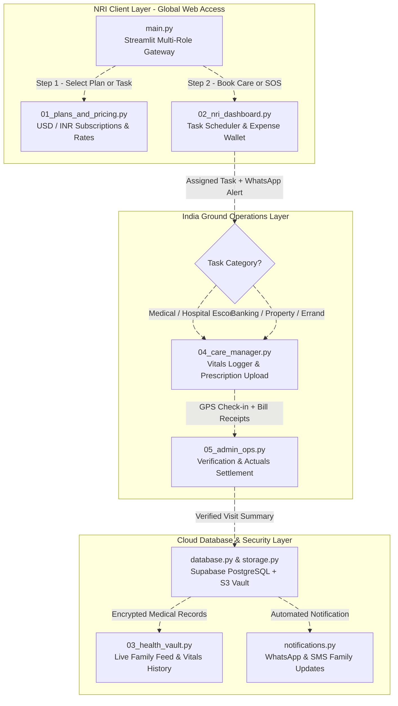

# CareBridge India — NRI Parent Care & Concierge Platform

A cloud-ready Streamlit web application for Non-Resident Indians (NRIs) to manage healthcare, daily errands, emergency support, and property concierge services for their aging parents in India.

## About

CareBridge India provides a transparent, real-time caregiving and concierge platform connecting NRIs abroad with verified local Care Managers (*Sahayaks*) in India. Families can subscribe to monthly care plans or book on-demand assistance for hospital visits, banking paperwork, bill payments, and home check-ins with live GPS verification and receipt proofs.

Built and maintained by [T A Srinivas (@SRINIVASTA)](https://github.com), this repository hosts a multi-role Streamlit web gateway, a multi-currency (USD/INR) billing and prepaid expense wallet, an encrypted medical and document vault, and a live Care Manager field reporting portal.

## Modules in this repo

| Module | Description |
| :--- | :--- |
| `main.py` | Main Streamlit entry point managing session state, role-based access routing (NRI, Care Manager, Admin), and USD/INR currency switching. |
| `01_plans_and_pricing.py` | Displays public monthly subscription tiers (Essential, Complete Medical + Errands, Couple Care) and pay-as-you-go service rate cards. |
| `02_nri_dashboard.py` | Enables NRIs to schedule medical or household tasks, manage their prepaid INR expense wallet, and trigger 24/7 emergency SOS alerts. |
| `03_health_vault.py` | Stores encrypted prescriptions, diagnostic lab reports, insurance policies, and chronological vitals logs (BP, blood sugar, pulse). |
| `04_care_manager.py` | Mobile-responsive field portal for local Care Managers in India to log GPS check-ins, record parent vitals, and upload expense receipts. |
| `05_admin_ops.py` | Operations panel for verifying ground staff KYC/police clearance, assigning tasks, and auditing out-of-pocket actuals. |

### Architecture & Workflow



### Key Capabilities

* **Unified Medical & Concierge Care:** Combines routine health monitoring, doctor appointment escorting, and 24/7 emergency hospital support with everyday errands like pension paperwork, utility bills, and property checks.
* **Transparent Prepaid Expense Wallet:** Separates service charges from 100% actual out-of-pocket costs (medicines, lab bills, cab fares), backed by mandatory photo receipt uploads before wallet deduction.
* **Multi-Currency Billing & Cloud Deployment:** Supports international USD/GBP/EUR subscriptions alongside INR billing, built for zero-setup deployment directly from GitHub Web to Streamlit Community Cloud.

## Service Pricing Reference

### Monthly Subscriptions

| Plan Tier | Monthly Charge (INR) | Monthly Charge (USD) | Included Coverage |
| :--- | :--- | :--- | :--- |
| **Essential Errands & Check-Ins** | ₹3,500 – ₹6,000 | $45 – $75 | 2 planned home visits/month, bill payments, banking help, grocery coordination, and photo updates. |
| **Complete Medical + Errands** | ₹7,500 – ₹12,500 | $90 – $150 | 4 weekly visits, BP/sugar checks, doctor appointment escorting, medicine refills, and 24/7 SOS. |
| **Comprehensive / Couple Care** | ₹14,000 – ₹22,000 | $170 – $265 | Weekly visits covering **both parents**, hospital escorting, lab coordination, and property checks. |

### Pay-As-You-Go On-Demand Rates

* **Doctor / Hospital Visit Escort (up to 4 hrs):** ₹1,000 – ₹2,500 ($12 – $30)
* **Routine Home Wellbeing & Vitals Check:** ₹600 – ₹1,200 ($8 – $15)
* **Bank, Government, or Pension Life Certificate:** ₹1,000 – ₹2,000 ($12 – $25)
* **Airport Pickup / Drop Assistance:** ₹1,500 – ₹3,500 ($18 – $42) *(excluding actual cab/toll)*
* **Property / Locked Flat Inspection:** ₹1,500 – ₹3,000 ($18 – $36)

## Repository Structure

```text
carebridge-nri-platform/
├── .github/
│   └── workflows/
│       └── ci-cd.yml                 # Automated linting, unit tests, and security checks on push
├── .streamlit/
│   ├── config.toml                   # Custom medical-teal theme, fonts, and 25 MB upload limit
│   └── secrets.toml.example          # Template for Supabase, Stripe, Razorpay, and Twilio keys
├── app/
│   ├── main.py                       # Main entry point, session initialization, and role-based router
│   ├── assets/
│   │   ├── logo.png                  # Brand logo and favicons
│   │   └── styles.css                # Custom CSS overrides for cards, badges, and responsive UI
│   ├── auth/
│   │   ├── session_manager.py        # Role-based access control (NRI, Care Manager, Admin)
│   │   └── login_ui.py               # Secure login, signup, and password reset screens
│   ├── pages/
│   │   ├── 01_plans_and_pricing.py   # Public USD/INR subscription plans and on-demand rate cards
│   │   ├── 02_nri_dashboard.py       # Service booking, prepaid wallet balance, and SOS trigger
│   │   ├── 03_health_vault.py        # Encrypted medical reports, prescriptions, and vitals trends
│   │   ├── 04_care_manager.py        # Ground staff GPS check-in, visit logging, and receipt upload
│   │   └── 05_admin_ops.py           # Staff verification (KYC/Police ID), payout, and dispatch panel
│   ├── services/
│   │   ├── database.py               # Supabase / PostgreSQL CRUD operations for users, tasks, and logs
│   │   ├── storage.py                # AWS S3 / Supabase Bucket handling for receipts and lab PDFs
│   │   ├── payments.py               # Stripe (International USD/GBP) and Razorpay (INR) integration
│   │   └── notifications.py          # WhatsApp Business API (Twilio/Gupshup) and SMS SOS alerts
│   ├── models/
│   │   └── schemas.py                # Pydantic data validation models for requests, vitals, and billing
│   └── utils/
│       ├── currency.py               # Live USD/INR conversion and receipt calculation helpers
│       └── validators.py             # Indian phone number, Aadhaar/ID mask, and file type checks
├── database/
│   └── migrations/
│       └── 001_initial_schema.sql    # SQL scripts for tables and Row-Level Security (RLS) policies
├── tests/
│   ├── test_billing.py               # Unit tests for subscription pricing and actuals wallet math
│   └── test_permissions.py           # Security tests ensuring NRIs only view their own parents' data
├── .gitignore                        # Excludes .streamlit/secrets.toml, __pycache__, and .env files
├── Dockerfile                        # Container setup for scalable deployment (AWS ECS / GCP Cloud Run)
├── pyproject.toml                    # Code formatting (Ruff/Black) and dependency management
├── requirements.txt                  # Pinned production Python dependencies
└── README.md                         # Setup guide, pricing reference, and architecture diagram
```

## Cloud & Local Setup

### 1. Local Development Setup

```bash
# Clone the repository
git clone https://github.com
cd carebridge-nri-platform

# Create and activate virtual environment
python -m venv venv
source venv/bin/activate        # On Windows: venv\Scripts\activate

# Install dependencies
pip install -r requirements.txt

# Copy secrets template and add your keys
cp .streamlit/secrets.toml.example .streamlit/secrets.toml

# Launch the application
streamlit run app/main.py
```

Open your browser and navigate to `http://localhost:8501`.

## License

This repository is licensed under the [MIT License](LICENSE) — Copyright (c) 2026 [T A Srinivas](https://github.com).

## Disclaimer

> **Important Notice:** This platform facilitates non-clinical care coordination, errand management, and home health monitoring. In the event of a critical medical emergency, local Care Managers coordinate immediate transport to the family's designated hospital, while all clinical diagnoses and treatments remain solely under the supervision of licensed medical practitioners.

